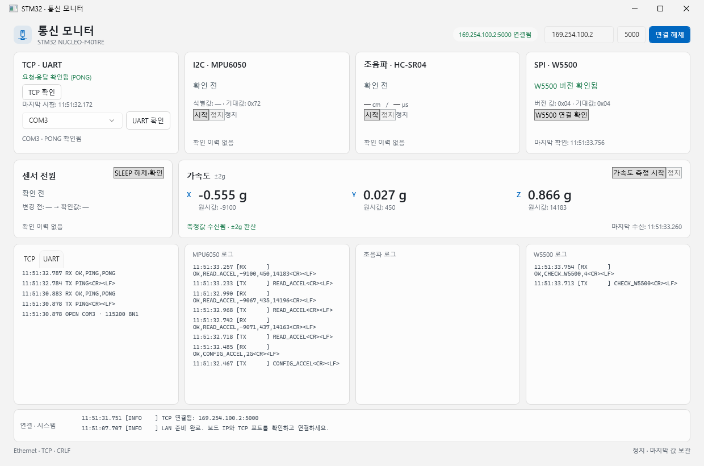
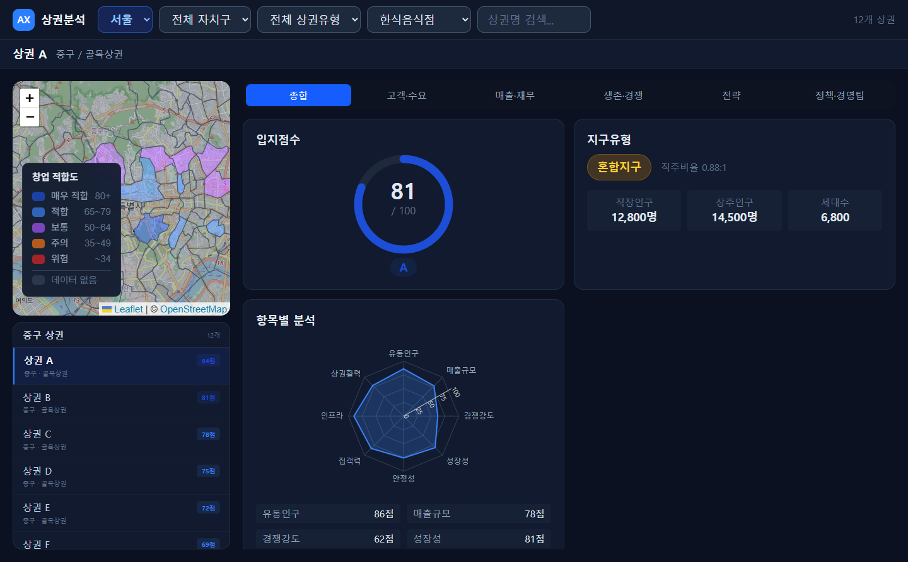
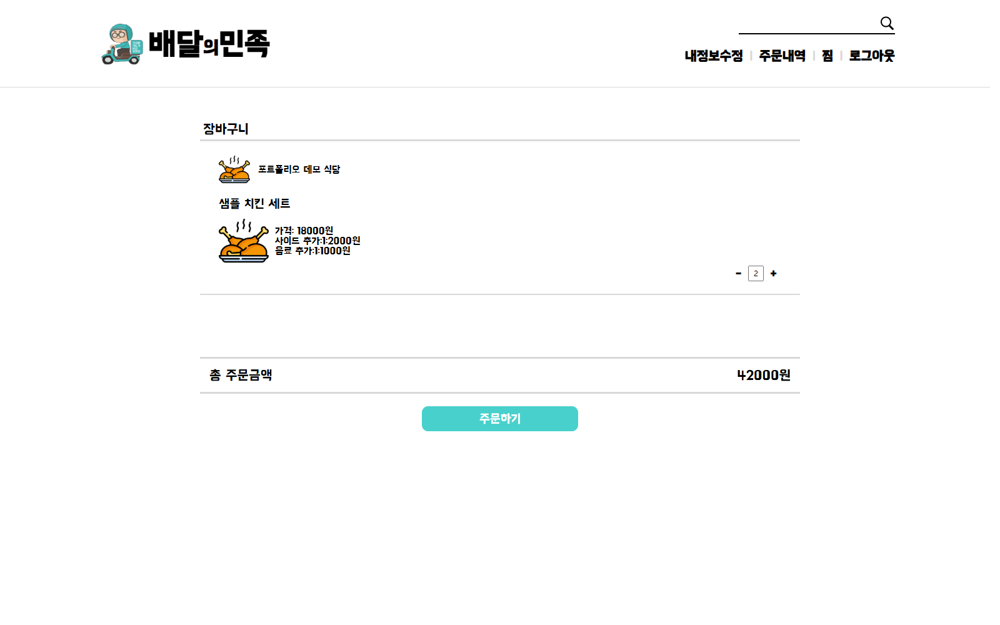
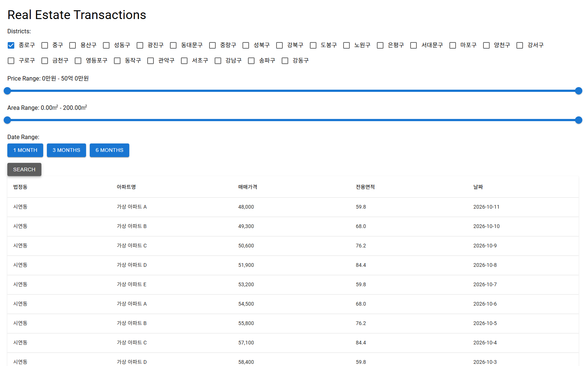

  <a href="https://khs220507.github.io/"><strong>기술 블로그</strong></a> &nbsp; · &nbsp;
  <a href="https://khs220507.github.io/cv/"><strong>경력 · CV</strong></a> &nbsp; · &nbsp;
  <a href="https://khs220507.github.io/about/#personal-projects"><strong>프로젝트 갤러리</strong></a>

### 김현수 · 장비와 소프트웨어를 연결하는 개발자

방산 시험장비·협동로봇 상위 제어 SW, 데이터 분석과 운영 UI 개발 경험을 바탕으로 임베디드·웹 프로젝트까지 개발 영역을 넓히고 있습니다. 블로그에는 구현 과정과 통신·임베디드 학습 내용을 기록합니다.

- **장비 제어** — C#·WPF 운영 화면, TCP/IP·Serial 연동, 상태 관리·장애 복구
- **데이터·웹** — 제조 데이터 전처리·예측 모델 비교, 지도·공공 API 기반 서비스
- **개인 임베디드 프로젝트** — STM32 센서 수집·통신과 WPF 모니터링
- **학습 중** — ROS 2·Gazebo 시뮬레이션

### 대표 프로젝트

<table>
  <tr>
    <td width="50%" valign="top">
      
      <h3>STM32 센서·통신 모니터링</h3>
      
<strong>개인 프로젝트 · 진행 중</strong> 센서 수집·장치 응답 확인과 PC 모니터링 연결

      
C · STM32F401RE · W5500 · C# WPF

      <a href="https://github.com/khs220507/stm32-automation_controller">소스 코드 ↗</a>
    </td>
    <td width="50%" valign="top">
      
      <h3>AX 상권분석 플랫폼</h3>
      
<strong>개인 프로젝트</strong> 상권 지도·목록·지역별 지표를 연결한 분석 UI

      
TypeScript · React · Leaflet · Python · FastAPI

      <a href="https://github.com/khs220507/AX_Project">소스 코드 ↗</a>
    </td>
  </tr>
  <tr>
    <td width="50%" valign="top">
      
      <h3>배달 주문 웹서비스</h3>
      
<strong>에이콘 · 팀장</strong> 주문·결제·리뷰, Oracle → MySQL 전환 및 Git 협업

      
Java · Spring MVC · JSP · MyBatis · MySQL

      <a href="https://github.com/khs220507/Acorn-Baemin">소스 코드 ↗</a>
    </td>
    <td width="50%" valign="top">
      
      <h3>부동산 실거래 조회</h3>
      
<strong>개인 프로젝트</strong> 공공 API 연동·지역·가격·면적·기간별 조건 검색

      
Java · Spring Boot · JavaScript · React

      <a href="https://github.com/khs220507/Real-Estate-App">소스 코드 ↗</a>
    </td>
  </tr>
</table>

웹 프로젝트 이미지는 시연용 데이터로 재현한 화면이며, 운영 수치나 모델 성능을 의미하지 않습니다.

[스마트홈·투두리스트·멜론 UI·GAN 등 전체 프로젝트 보기 →](https://khs220507.github.io/about/#personal-projects)

### 기술 스택

| 분야 | 기술 |
| --- | --- |
| Application / UI | C# · .NET · WPF · MVVM · Python · PyQt · Flutter |
| Embedded / Communication | C · STM32 · CMSIS · UART · SPI · I²C · RS-485 · TCP/IP |
| Data / AI | pandas · NumPy · Scikit-learn · TensorFlow/Keras · PyTorch · XGBoost |
| Web / Database | Java · Spring · React · FastAPI · MS SQL Server · MySQL · Oracle SQL |
| Collaboration | Git · GitHub · GitLab · Redmine · 요구사항·설계·시험 문서화 |

### 블로그 최근 글

<!-- BLOG-POSTS:START -->
- [STM32 UART — 인터럽트 수신과 문자열 LED 명령](https://khs220507.github.io/posts/uart/)
- [STM32 DMA — ReceiveToIdle과 RX Ring Buffer](https://khs220507.github.io/posts/uart-dma/)
- [STM32 Timer — TIM2 인터럽트로 500ms 샘플링](https://khs220507.github.io/posts/timer-sampling/)
- [STM32 HAL — Handle·함수·IRQ·Callback 연결](https://khs220507.github.io/posts/stm32-hal/)
- [STM32 PWM — CdS 값으로 LED 밝기 조절하기](https://khs220507.github.io/posts/pwm-led/)
<!-- BLOG-POSTS:END -->

[전체 글 보기 →](https://khs220507.github.io/) · [임베디드 학습 노트 →](https://khs220507.github.io/posts/embedded-learning/)

---

회사 프로젝트 경험은 [CV](https://khs220507.github.io/cv/)에서 텍스트로 소개하고, 이 프로필에는 개인·교육 프로젝트 화면만 수록합니다.

